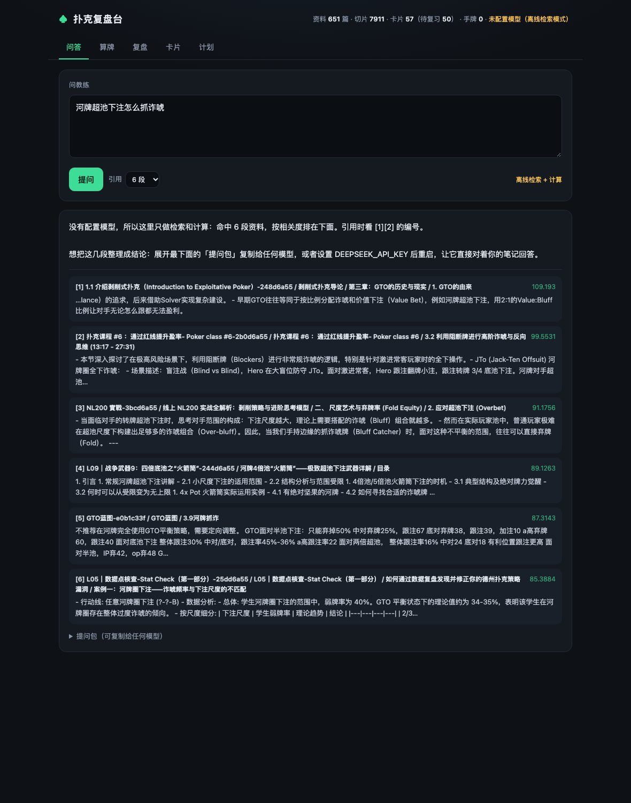

# 扑克复盘台

## 怎么打开（最快）

**双击桌面上的「扑克复盘台」图标**（也可以在启动台里搜「扑克复盘台」）。

- 没在运行 → 自动启动并在浏览器打开页面
- 已经在运行 → 弹窗让你选「打开页面」或「停止服务」
- 图标是项目里 `app/扑克复盘台.app` 的副本，装在 `~/Desktop` 和 `~/Applications`

如果提示「无法验证开发者」：右键点图标 → **打开** → 再点一次「打开」，只需一次。

> 图标里的启动路径是写死的（指向这个项目文件夹）。如果以后移动了项目，图标会提示找不到。

备用的启动方式（Finder 里双击 `打开扑克复盘台.command`）：

- 会弹出一个终端窗口，然后浏览器自动打开 `http://127.0.0.1:8770`
- 关掉终端窗口（或按 `Ctrl+C`）就是关闭
- 如果提示的端口不是 8770，说明之前已经开着一个了——把旧窗口关掉再双击一次

也可以从终端启动（注意用带 numpy 的解释器，macOS 自带的 python3 没有）：

```bash
cd ~/Documents/deepseek-harness/default-workspace/poker-coach
./打开扑克复盘台.command
```

> 首次使用必须先跑一次 `python3 run.py init`，并把资料放进 `data/notes/`。本机已经把
> Notion / 印象笔记 / 手牌都导好了，直接双击就行。

一个跑在你本机的扑克学习助手：**读你的笔记和课程录屏**，用**确定性代码算牌**，再用**模型解释**。



不是"训练一个 AI 替你打牌"。它做四件事：

1. **检索**：你问"BTN 被 3bet 后怎么防"，它从你自己的笔记里找出相关段落，带出处（笔记名 / 小标题 / 视频时间点）。
2. **计算**：胜率、底池赔率、EV、MDF 全部由本地代码算，精确枚举或蒙特卡洛，模型不许自己心算。
3. **学习闭环**：笔记里的 Q/A 和"原则"自动变成复习卡，间隔重复；每手牌记下来，让教练对着你的笔记复盘。
4. **计划**：每天给你一份 25 分钟的执行清单（先做卡片，再精读你最容易错的那一节）。

## 为什么这样设计

| 常见误区 | 这里的做法 |
|---|---|
| 让模型"看完视频就学会扑克" | 模型权重不会变。视频只用来提取讲解（Whisper 转录），知识靠检索命中 |
| 让模型算胜率 | 模型算牌必错。所有数字走 `pokercoach/equity.py`，36 个单元测试兜底 |
| 把整本书塞进 prompt | 上下文又贵又不准。只检索 4~10 段最相关的切片 |
| 手牌数据上云 | 全部本地 SQLite，不出机器 |

## 关于"会不会烧掉很多 token"

**入库、建索引、转录，一个 token 都不花。** 这三步全是本地计算：

- 切片 + 建索引：本地 BM25，纯 Python
- 录屏转录：本地 Whisper（CPU），花的是时间不是 token
- 算牌：本地枚举/蒙特卡洛

只有你**提问**的那一下才会调模型，而且只发检索出来的 4~6 段（约 1.5k~3k token）。

真正的问题是**几千小时的视频本身**：1000 小时课程 ≈ 900 万汉字，一次性喂给任何模型都不现实（也超出上下文）。

所以正确的分层是：

| 层 | 内容 | 什么时候做 | 成本 |
|---|---|---|---|
| 1 | **Notion 里的 AI 总结笔记** | 全部入库 | 0 token，几秒 |
| 2 | 印象笔记 / 原始讲义 | 全部入库 | 0 token，几秒 |
| 3 | 逐字稿 | **只转录你最近在学的主题**（比如河牌 + 多人底池） | 0 token，CPU 时间 |
| 4 | 原视频 | 不转录。先靠总结和逐字稿定位到时间点，再回看那 10 分钟 | 0 |

检索时，标题里含「总结 / 摘要 / 大纲 / 提炼」的资料会自动加权 25%——你的 AI 总结笔记天然排前面。

## 导入你的资料

### Notion（推荐，增量）

1. 打开 <https://www.notion.so/my-integrations> → New integration → 复制 token（`ntn_...` 或 `secret_...`）
2. 在 Notion 里打开课程页面的根节点 → 右上角 `···` → **Connections** → 添加你刚建的 integration
3. 导入：

```bash
python run.py import notion --token ntn_xxxx
```

会导出成 `data/notes/notion/*.md`（可读、可手改、可备份），然后自动入库。已有文件会跳过，所以可以反复运行做增量更新。

### 直接读本机客户端的数据（推荐，不用 token、不用导出）

Notion 桌面版和印象笔记都会把内容缓存到本地，直接读：

```bash
python run.py import notion-local      # 读 ~/Library/Application Support/Notion/notion.db
python run.py import evernote-local    # 读印象笔记的 LocalNoteStore.sqlite + content.enml
```

- 只读：会先复制一份数据库再解析，绝不改动你的原库
- 增量：已导出的页面会跳过，可反复运行
- 印象笔记默认只导入扑克相关笔记（按笔记本名和关键词判断），加 `--all` 导入全部

实测规模参考：651 篇文档、7911 个切片、462 个视频引用，索引时间几秒。

> 限制：Notion 只缓存你**打开过**的页面。没打开过的页面需要先在客户端翻一遍，或者用下面的 API / 导出包。

### Notion 导出包（不想给 token 就用这个）

Notion 页面 → `···` → Export → **Markdown & CSV** → 解压出 zip：

```bash
python run.py import notion-zip ~/Downloads/Export-xxxx.zip
```

### 印象笔记

`.enex` 导出文件直接喂进来：

```bash
python run.py import evernote ~/Downloads/我的笔记.enex
```

会解析 ENML，保留标题层级、列表和标签，写成 `data/notes/evernote/*.md`。

## 快速开始

```bash
cd poker-coach
python3 run.py init          # 建目录，放入《如何整理笔记》
python3 run.py import notion --token ntn_xxx
python3 run.py serve         # 打开 http://127.0.0.1:8770
```

想先看看长什么样，用示例资料：

```bash
python3 run.py demo          # http://127.0.0.1:8771
```

## 接不接模型都能用

- **不接**：问答返回检索到的原文 + 自动算好的数字 + 一份可以直接粘贴给任何模型的"提问包"。全部本地，零成本。
- **接了**：`export DEEPSEEK_API_KEY=sk-...` 再启动，模型基于检索结果回答，并强制引用 `[1][2]`。

兼容任何 OpenAI 格式接口：

```bash
export POKERCOACH_BASE_URL=http://127.0.0.1:8000/v1
export POKERCOACH_MODEL=qwen2.5-72b-instruct
```

## 按主题批量转录

几千小时视频不可能全转。先看清单，再只转你需要的：

```bash
python run.py transcribe --topic 河牌 --dry-run     # 只看这个主题下有哪些视频
python run.py transcribe --topic 河牌               # 只转本地已有的文件
```

- 视频主题是自动判断的：先看文件名，再看它所在页面的标题
- Notion 里的视频是云端的（本地没有缓存），需要你先下载到 `data/recordings/`
- 已经转过的会跳过，可以分批、断点续跑
- 转录产物带时间轴，检索结果里能看到 `@12:34`

## 生成学习路径

```bash
python run.py path --weeks 4 --days 5
```

从你的资料里排出一条 4 周、每周 5 天的路径：

- 章节自动归类到主题（翻前 → 3bet → 翻牌 → 转牌 → 河牌 → 多人底池 → 剥削 → 心理）
- 跳过"目录 / FAQ / 前言 / 概览"这类模板小节
- 每个主题的名额按体量平方根分配，避免"翻前"一个主题吃掉整条路径
- 每天 1 个章节 + 卡片目标，结果存成 `data/plan.json`，界面「计划」页也能看

## 复习卡片：2,700 张自动生成

从结构化笔记里挖三种卡，都要求「问题唯一、答案很短」：

| 类型 | 例子 | 数量 |
|---|---|---|
| 定义卡 | 「极化优势（Polarization）」是什么意思？ | 1,834 |
| 数字卡 | 面对小尺度下注（____底池） → 33% | 769 |
| 结论卡 | 《这一节》最重要的结论是什么？ | 55 |
| Q/A 卡 | 你笔记里手写的 `Q:/A:` | 48 |

```bash
python run.py cards --sample 8    # 随机抽几张看质量
python run.py cards --rebuild     # 重新生成（复习进度不会丢）
```

精修用的是**全库文档频率**，不需要模型：

- 同一个"概念"在 5 篇以上文档里都当术语出现 → 它是小节名（`纠偏` 45 次、`误区二` 39 次、`行动线` 16 次），删
- 同一个问题在多篇笔记里重复 → 只留答案最完整的那一张
- 一张卡在 2,700 张里被删掉约 600 张模板词 + 300 张重复卡

两个设计要点：

- **卡片有稳定 key**（问题文本的哈希），重新 ingest / 重建只增删真正变化的卡，复习记录跟着走，不会被清空。
- **宁可少而准**：16,554 条 bullet 里，8,295 条长得像定义，经过术语词性、答案长度、表格残行、牌面/牌例过滤后剩 2,700 张。抽到没用的，复习时点「这张没用」删掉即可。

## 手牌复盘：14,798 手 → 漏洞 → 学习路径

把 GG 导出的手牌 txt 放进来，一条命令出报告：

```bash
python run.py hh data/hh/raw
```

- 解析 GGPoker 原生格式（含 Rush & Cash），`collected` / `uncalled bet` 都算进去，净输赢才是对的
- 每手压成标记（VPIP / PFR / 3bet / cbet / 弃给 cbet / WTSD…），**每个比率配独立的分母**（机会数），不拿总手数凑
- 和微级别经验区间比对，按偏离程度排序，给出「该补什么」

实测报告（NL2 六人桌，14,798 手，+29.6 bb/100）：

| 指标 | 你 | 基准 | 结论 |
|---|---|---|---|
| BTN 开池 | 22.4% | 36~52 | 按钮位太紧，最赚钱的位置在漏钱 |
| SB 开池 | 11.9% | 28~55 | SB 大量弃牌/平跟，没在争盲 |
| 弃给 cbet | 27.4% | 38~56 | 跟注太宽，转牌难受 |
| WTSD | 18.7% | 24~34 | 摊牌太少，被价值下注打穿 |

漏洞会**自动写回学习路径**：对应主题加权 2.5 倍、排到前面。`python run.py path` 直接用。

### 开池范围矩阵

「复盘」页里把实际开池频率叠到 13×13 矩阵上：绿色=正常开，红色=该开没开，紫色=开得过多，深灰=不在基准范围。

```
BTN 实际 43.5% / 基准 46.6% · 漏 1 类（53s）· 多 2 类（K2s、J5s）
CO  实际 27.0% / 基准 34.8% · 漏 7 类（Q9o、A7o、A8o、T9o、J9o、K9o、55）
```

- 基准范围写在 `pokercoach/hh/rangechart.py` 的 `REFERENCE`，改一行就能换基准
- 开池率按**组合数加权**（和 HUD 的 RFI 口径一致），不是按手牌种类数
- 分母只算「前面没人加注」的手数——这点很容易错，错了会得出完全相反的结论

## 卡片按主题筛

「卡片」页顶部有主题下拉，只做你正在学的那一块（比如这周只看「翻牌持续下注」），
不用在 2000 多张卡里随机游走。

## 怎么学得更快

三个刻意的设计，都有学习科学的依据：

**1. 先默写，再翻答案**（生成效应）
复习时先让你用自己的话写，翻答案后自动比对关键词，给出「命中 62% · 漏了：防守、频率」。主动回忆一次，比被动读五遍记得牢。

**2. 掌握度按间隔算，不按感觉算**
「进度」页把每张卡分成 未开始 / 在学 / 已掌握（间隔 ≥ 7 天），按主题汇总成进度条。哪块是 0% 一眼就能看见——你的时间应该花在那里，而不是反复看已经会的。

**3. 错题本直接连回原文**
忘了 ≥1 次的卡会进错题本，带出处和遗忘次数，点「回看这一节」直接把这节内容调出来重读。忘记 → 回看 → 再测，闭环在同一个界面里完成。

## 四个页面

- **问答**：提问，看回答、出处、自动计算。问题里出现"AKs vs 22"、"底池 100 下注 75"会自动算。
- **算牌**：手牌/范围 vs 范围，翻前翻后都能算；底池赔率、MDF、EV。
- **复盘**：记一手牌（位置、牌面、行动线、当时想法），一键让教练对着你的笔记分析。
- **卡片 + 计划**：自动生成的复习卡按 SM-2 排期；计划页给出今天该做什么。

## 笔记怎么写，检索才准

一篇一个主题，用 `##` 把小标题写成具体场景（`## BTN vs CO 的 3bet 范围`），用 `Q:/A:` 写卡片，用 `原则：` 写一句话结论。详见 `data/notes/如何整理笔记.md`。

## 录屏转录（可选，按需）

只转录你正在学的主题，不要一次全转。先装依赖：

```bash
python3 -m venv .venv --system-site-packages
.venv/bin/pip install faster-whisper pypdf
```

然后把**选定**的录屏放进 `data/recordings/`，跑 `ingest`：

```bash
.venv/bin/python run.py ingest --model small
```

- 模型大小：`tiny` / `base` / `small` / `medium`。M2 上 `small` 大约 1 小时音频 10~20 分钟。
- 已有字幕（`.srt` / `.vtt`）最省事，直接放 `data/transcripts/`，不走 Whisper。
- 转录产物是 `data/transcripts/*.json` + `.srt`，切片带时间轴，回答里能看到 `@12:34` 并跳回原视频。

> 如果安装卡住，换成 Apple 芯片更快的 `mlx-whisper`，或者先用 Notion 的总结笔记跑起来，转录晚点再补。

## 数学引擎

```bash
python3 run.py equity "AhJh" "QQ+" "Qh7h2c"
python3 run.py odds 100 75 --equity 47.5
```

- river 永远精确枚举；flop/turn 在小范围下精确枚举；翻前和大范围用蒙特卡洛（默认 2 万次，误差约 ±0.35%）。
- 牌力评估器用 5~7 张牌向量化编码，和一份独立的朴素实现在 3000 手随机牌上比对通过（0 处不一致）。
- 测试：`python3 -m unittest discover -s tests -v`

## 目录

```
poker-coach/
├── run.py                 命令行入口
├── pokercoach/
│   ├── equity.py          牌力评估 + 胜率（精确/蒙特卡洛）
│   ├── odds.py            底池赔率、EV、MDF、SPR
│   ├── ranges.py          范围解析：AKs / TT+ / A5s-A2s / 权重
│   ├── index.py           中文分词 + BM25（零依赖）
│   ├── ingest.py          笔记/PDF/字幕/录屏 → 切片与卡片
│   ├── importers/         Notion（本地库 / API / 导出包）、印象笔记（本地库 / .enex）
│   ├── hh/                手牌解析（GG）＋ 统计与漏洞识别
│   ├── topics.py          主题体系（归类、判断是否扑克内容）
│   ├── path.py            学习路径生成
│   ├── transcribe_batch.py 按主题批量转录
│   ├── coach.py           检索 + 自动计算 + 模型调用 + 学习计划
│   ├── store.py           SQLite
│   ├── server.py          本地 Web 服务（标准库）
│   └── web/               界面
├── data/                  你的资料（notes / transcripts / recordings）
├── samples/               示例资料
└── tests/                 36 个测试
```

## 已知限制

- **还没有手牌历史（HH）解析**。GG/PS 导出的手牌文件是下一步最有价值的东西：能直接算每条街的频率、找最大漏洞。现在是手动记牌。
- **视频画面没做 OCR**。只转录讲解，牌面/底池数字识别要另加一路抽帧 + OCR。
- **卡片仍有一小部分噪声**。规则生成做不到 100% 准确，抽到没用的点「这张没用」删掉即可；也可以再跑一次 `cards --rebuild` 让全库统计把新出现的模板词筛掉。
- **检索是 BM25，不是向量检索**。几千条切片够用、可解释；上万条再考虑加 embedding。
- **不提供打牌时的实时提示**。所有平台都禁止 RTA，封号 + 没收资金；复盘才是涨棋的地方。

## 下一步可以加

1. 手牌历史解析 → 自动统计（位置频率、各街弃牌率、亏损最大的 spot）
2. 录屏 OCR → 把牌面绑到讲解时间轴
3. 漏洞报告：把你手牌库的统计和笔记里的原则逐条对照，列出"你说的"和"你做的"的差
